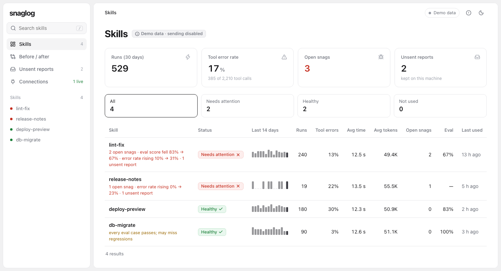
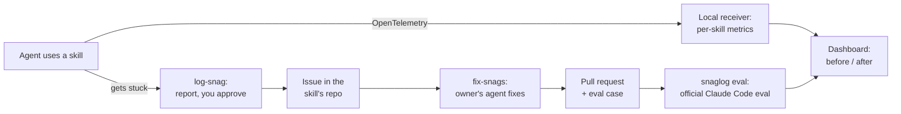
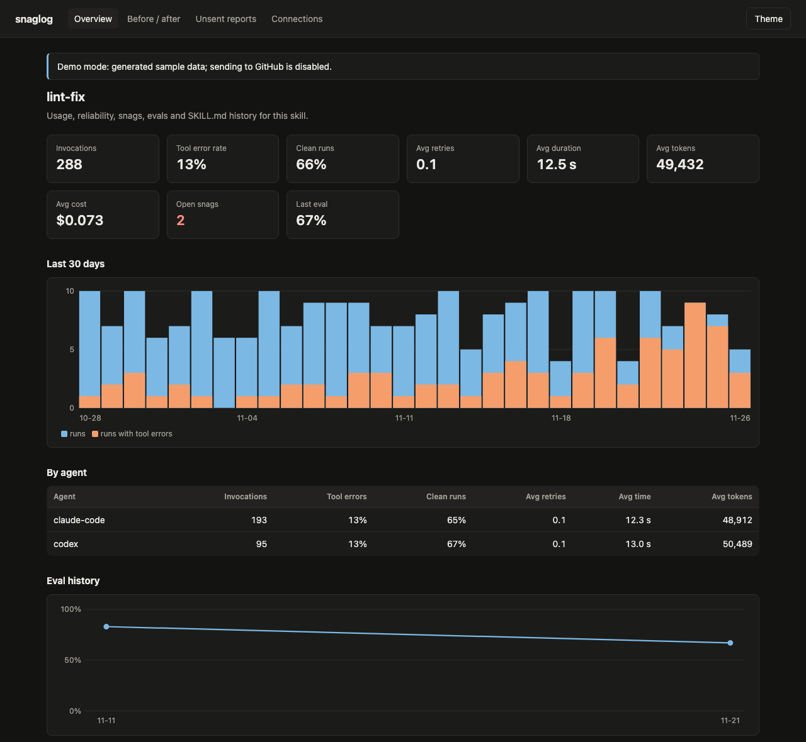

# snaglog

**Find out which of your team's agent skills are broken, get them fixed, and prove the fix worked.**

snaglog gives a team a measure → report → fix → verify loop for its own agent skills (`SKILL.md`), across Claude Code and Codex. It runs on your machine, uses only the agents' official features, and sends nothing anywhere without your approval.



## Why

Skills break quietly. A documented flag gets renamed, a command reports success but does nothing, a step needs three tries. The agent works around it and finishes the task, and the skill's owner never hears about it. The next person hits the same wall.

In snaglog's [end-to-end trial](docs/E2E-TRIAL.md), a skill told agents to run `wc --lines-only`, a flag that does not exist. snaglog turned that into:

1. a snag report the user approved, filed as an issue in the skill's own repo;
2. two repeat reports, added to the same issue instead of opening new ones;
3. telemetry showing a 100% tool error rate for that skill;
4. a pull request from the skill owner's agent that fixed the step, added an eval case reproducing the snag, and linked the issue;
5. a before/after view showing the error rate drop from 100% to 0% (with a warning that the sample was still small).

## How it works



| Part | What it does |
|---|---|
| **`log-snag`** skill | When a skill doesn't work as described, the agent drafts a sanitized report, shows you the exact text, the target repo and what was masked, and files it only after you approve. Repeats are added to the open issue. With nobody to ask, the report stays on your machine. |
| **`fix-snags`** skill | For the skill's owner: groups open reports by root cause (with telemetry as evidence), edits the skill on a branch, turns each snag into an eval case and opens a pull request with `Fixes #N`. It never merges. |
| **Telemetry** | A receiver on `127.0.0.1` turns Claude Code and Codex OpenTelemetry events into per-skill usage, tool errors, retries, duration, tokens and cost. Prompt text and tool output are never stored. |
| **`snaglog eval`** | Runs Claude Code's official `claude plugin eval` for the skills that changed and records each result with the skill's git commit. Shows an estimate and a hard cost ceiling first. |
| **Dashboard** | Ranks the skills that need attention, compares agents, and shows metrics before and after every `SKILL.md` change. |

## Quick start

snaglog needs Node.js 22 or later and has no npm dependencies. It is not published to npm yet; install it from a clone of this repository:

```bash
npm link
```

Look at the dashboard with generated sample data (nothing is read from your machine):

```bash
snaglog dashboard --demo
```

Open http://127.0.0.1:4747.

**New to snaglog?** [docs/GETTING-STARTED.md](docs/GETTING-STARTED.md) walks one project from zero to a working loop.

## Set up a project or skills repo (once, by a maintainer)

snaglog works with a project that keeps its skills in `.claude/skills/<name>/SKILL.md`, and with a dedicated skills repo that keeps them in `skills/<name>/SKILL.md`. In a local checkout, review the plan first:

```bash
snaglog init --repo acme/skills --dry-run
```

Then apply it:

```bash
snaglog init --repo acme/skills
```

`init` changes nothing until you confirm. It:

1. adds `metadata.snaglog-repo: acme/skills` to every `SKILL.md`, without touching other fields, comments or line endings;
2. appends one line to every `SKILL.md`: *If this skill doesn't work as described, file a snag with the log-snag skill before working around it.*;
3. creates the `skill-friction` and `skill:<name>` labels on GitHub (only the missing ones);
4. copies the `log-snag` and `fix-snags` skills into the repo;
5. creates an inactive eval skeleton for skills without one, in `.claude/evals/<skill>/` (a project) or `evals/<skill>/` (a skills repo);
6. adds the eval results folder to `.gitignore`, because full eval reports contain transcripts.

In a project with no skills yet, `log-snag` and `fix-snags` go to `.claude/skills/`, where Claude Code loads them.

Running it again finds nothing to do. Review the result with `git diff` and commit it.

snaglog does not distribute skills: `log-snag` and `fix-snags` reach your team the same way your other skills do (a plugin marketplace, a shared folder, a project's `.claude/skills`).

## Connect your agents (every team member)

```bash
snaglog connect claude-code
```

```bash
snaglog connect codex
```

Each command shows every change to the agent's settings file, asks, backs the file up to `~/.snaglog/backups/` and then writes. Restart the agent afterwards. To undo:

```bash
snaglog disconnect claude-code
```

`disconnect` restores the original file byte for byte if you have not edited it since; otherwise it reverts only snaglog's settings and keeps your edits.

What `connect` changes:

- **Claude Code** (`~/.claude/settings.json`): log events only, as OTLP JSON to `http://127.0.0.1:4318/v1/logs`; prompt, response, tool-detail, tool-content and raw-body logging all off; and a small local hook that records which skill ran (Claude Code's telemetry names custom skills only `custom_skill`). Metrics and traces you already send elsewhere are left alone.
- **Codex** (`~/.codex/config.toml`): in `[otel]`, an `exporter` pointing at snaglog and `log_user_prompt = false`; other keys are kept. Codex separately sends usage metrics to OpenAI by default (`metrics_exporter = "statsig"`); snaglog does not change that, and `connect` tells you how to turn it off.

Telemetry is collected while the dashboard runs:

```bash
snaglog dashboard
```

This starts the receiver on `127.0.0.1:4318` and the dashboard on http://127.0.0.1:4747. Events sent while it is not running are not collected.

### Using Claude Code Desktop

Claude Code Desktop uses the same `~/.claude/settings.json`, so `connect` covers it too. Run the `snaglog` commands from the app's Terminal panel, or ask Claude in the chat to run them: it shows the `--dry-run` plan, and runs the command with `--yes` only after you approve. Keep `snaglog dashboard` running in a Terminal tab. Desktop has not been part of the end-to-end trial yet.

### Supported agents

| Agent | Status |
|---|---|
| Claude Code | Supported; verified end to end ([trial](docs/E2E-TRIAL.md)). |
| Codex | Supported (builds from 2026-09-30, which emit `codex.skill_invocation`); not yet verified with a live session. |
| GitHub Copilot in VS Code, Gemini CLI | Planned. |
| OpenCode, Cursor | Not supported until they offer official local OpenTelemetry export; snaglog does not use community plugins or hook bridges. |
| ChatGPT (web and desktop) | Not supported: it has no telemetry export. |

## Day to day

**When a skill gets in the agent's way,** the agent uses `log-snag`: you see the exact report and choose *file*, *edit* or *don't file*.

**Collect snags** (read-only on GitHub) and eval results for the dashboard:

```bash
snaglog collect --repo acme/skills
```

**Run evals.** Evals cost money (your Claude subscription usage or API billing), so snaglog always shows the plan, an estimate and a hard ceiling first, and asks:

```bash
snaglog eval --dry-run
```

```bash
snaglog eval deploy-preview --ablate
```

The first eval in a repo needs `--trust-plugin`: Claude Code runs only plugins you trust, and snaglog asks you to confirm that in a terminal. Without a skill name, only skills whose `SKILL.md`, scripts or eval cases changed since their last recorded eval are selected; `--all` selects every skill with eval cases. `--ablate` adds a baseline run without the repo's skills to show how much they help. Each run stops at `--max-cost-usd` (default $1).

**Fix snags** (skill owners): ask your agent to fix the snags of a skill. It uses `fix-snags`, shows you the grouped reports, and asks before each change, each eval and the pull request. Claude Code protects skill files, so approve each edit when it asks.

## The dashboard

| Page | Shows |
|---|---|
| Overview | All skills, the ones that need attention first: open snags, falling eval scores, rising error rates, unsent reports, suites that always pass |
| Skill | Usage over 30 days, comparison by agent, eval history, snags and `SKILL.md` changes |
| Before / after | Metrics before and after a chosen `SKILL.md` change, with a verdict |
| Unsent reports | Reports kept on this machine: edit, send or delete |
| Connections | Which agents are connected, when the last event arrived, what to check if nothing arrives |




## Privacy and security

- **Nothing leaves your machine unless you approve it.** The receiver and dashboard listen on `127.0.0.1` only, and snaglog sends no telemetry of its own. The only writes to GitHub are the issues, labels and pull requests you approve.
- **Never stored:** prompt text, assistant responses, tool arguments, tool output, error text, file contents, emails, account IDs or host names. Adapters copy an allow-list of fields from each event and drop the rest, even if detailed logging was turned on. Session IDs are stored only as salted hashes.
- **Snag reports are sanitized twice.** The agent removes secrets, personal and customer data, the user's prompt text and file contents. The script then masks known token formats (GitHub, GitLab, OpenAI, Anthropic, AWS, Slack, Google, Stripe, npm, JWTs, private keys), credentials in headers, URLs and `key=value` assignments, emails, IP addresses and home-directory paths, before any truncation. An approval token ties what you approved to what is filed.
- **Unattended runs never file.** With nobody to ask (CI, scheduled runs), reports stay in `~/.snaglog/snags.jsonl`.
- **Evals** always run with `--no-publish` (otherwise Claude Code publishes the report to claude.ai) and never with flags that run extra scripts; full results are deleted once an allow-listed summary is stored.
- **The dashboard** checks the `Host` header, needs a per-start token for every API call and a same-origin request for changes, and serves a strict Content-Security-Policy. It loads nothing from the network.
- **Issue text is untrusted.** `fix-snags` treats report text as evidence and never follows instructions found in it.
- **Official building blocks only:** the agents' own telemetry, hooks and eval command, the Agent Skills and OpenTelemetry standards, GitHub's `gh`, and Node.js built-ins.

All data lives in `~/.snaglog/` (directories `0700`, files `0600`); [docs/AGENT-ADAPTERS.md](docs/AGENT-ADAPTERS.md) lists every file.

## How snaglog differs

Existing skill-feedback tools file to one fixed repository, file without asking, or only hand you text to paste. Existing local agent dashboards measure tokens, cost and tools per session or model, not per skill. snaglog is built around the skill:

- reports go to **each skill's own repository**, after approval, with a local fallback;
- telemetry, snags and evals are joined **per skill and per skill version**, across agents;
- fixes come back as **pull requests with eval cases**, and the dashboard shows whether they helped;
- one command wires **every skill in a repository**.

## Requirements

| What | Who needs it | Why |
|---|---|---|
| Node.js 22 or later | everyone | snaglog has no npm dependencies |
| `git` | everyone | `SKILL.md` history, commits for eval results |
| GitHub CLI, logged in (`gh auth login`), with access to the skills repo | everyone who files or fixes snags | issues, labels and pull requests go through the official `gh` |
| Claude Code 2.1.269 or later (and git 2.31 or later) | whoever runs evals | `snaglog eval` uses `claude plugin eval` |
| Claude Code and/or Codex | everyone who wants telemetry | their built-in OpenTelemetry export |

## Limitations

- Codex support is built from Codex's source code and has not been checked against a live Codex session.
- The receiver accepts OTLP JSON only; protobuf requests are rejected with a clear error.
- Team mode (one shared receiver for a team) is designed but not implemented; endpoints are loopback-only.
- Evals need Claude Code; there is no official eval runner for Codex.

## Documentation

- [docs/GETTING-STARTED.md](docs/GETTING-STARTED.md): add snaglog to a project, step by step.
- [docs/E2E-TRIAL.md](docs/E2E-TRIAL.md): the end-to-end trial on a real repository, and what it changed.
- [docs/AGENT-ADAPTERS.md](docs/AGENT-ADAPTERS.md): agent telemetry, how skill use is recognised, stored files.
- [docs/ECOSYSTEM.md](docs/ECOSYSTEM.md): trust policy, and the standards and official tools snaglog builds on.
- [CONTRIBUTING.md](CONTRIBUTING.md): development, tests, and writing a new agent adapter.
- [CHANGELOG.md](CHANGELOG.md)

## License

[MIT](LICENSE)
