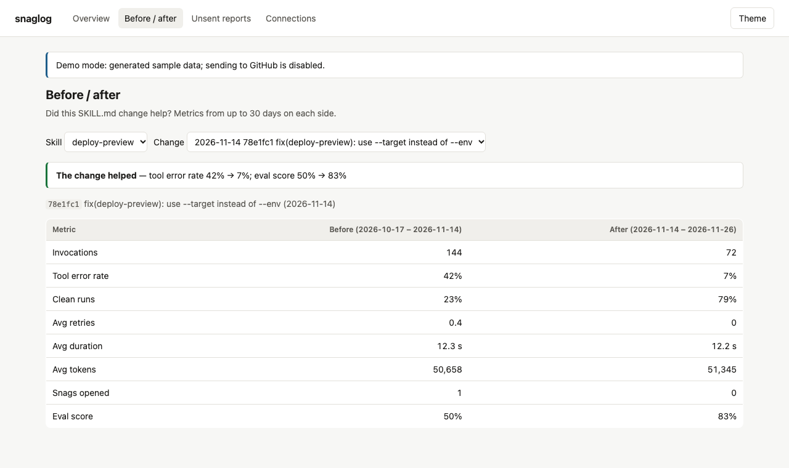

# snaglog

**Measure, report, fix and verify your team's agent skills.**

Agent skills (`SKILL.md`) break quietly: a documented flag is renamed, a command reports success but does nothing, a step needs three tries. The agent works around it, and the skill's owner never hears about it. snaglog closes that loop for a team's own, usually private, skills repository:

1. **Report** — when an agent hits a snag in a skill, the `log-snag` skill drafts a sanitized report, shows it to the user, and only after approval files it (or adds to an existing one) as an issue in the skill's own repo. Without approval, or with nobody to ask, the report stays on the machine.
2. **Fix** — the skill's owner runs the `fix-snags` skill: it groups the open reports by root cause, edits the skill on a branch, turns each snag into an eval case and opens a pull request that links the issues. It never merges.
3. **Measure** — a local OpenTelemetry receiver turns events from Claude Code and Codex into per-skill metrics: usage, tool errors, retries, duration, tokens, cost. Prompt text and tool output are never stored.
4. **Verify** — `snaglog eval` runs Claude Code's official `claude plugin eval` per skill and records each result with the skill's git commit. A local dashboard shows every skill, ranks the ones that need attention, and compares metrics before and after each `SKILL.md` change.


## Requirements

| What | Who needs it | Why |
|---|---|---|
| Node.js 22 or later | everyone | snaglog has no npm dependencies |
| `git` | everyone | SKILL.md history, commits for eval results |
| GitHub CLI, logged in (`gh auth login`), with access to the skills repo | everyone who files or fixes snags | issues, labels and pull requests go through the official `gh` |
| Claude Code 2.1.269 or later (git 2.31 or later) | whoever runs evals | `snaglog eval` uses `claude plugin eval` |
| Claude Code and/or Codex | everyone who wants telemetry | their built-in OpenTelemetry export |

## Install

snaglog is not published to npm. From a checkout of this repository:

```bash
npm link
```

This makes the `snaglog` command available. Check it with:

```bash
snaglog --help
```

Without linking, run `node cli/snaglog.mjs` from the checkout instead of `snaglog`.

## Try the dashboard first

```bash
snaglog dashboard --demo
```

Open http://127.0.0.1:4747. Demo mode shows generated sample data from a temporary folder; nothing is read from your machine and sending to GitHub is disabled.

## Set up a skills repo (once, by a maintainer)

In a local checkout of the skills repo (skills in `skills/<name>/SKILL.md`):

```bash
snaglog init --repo acme/skills --dry-run
```

```bash
snaglog init --repo acme/skills
```

`init` shows its full plan and changes nothing until you confirm. It:

1. adds `metadata.snaglog-repo: acme/skills` to every `SKILL.md`, without touching other fields, comments or line endings;
2. appends one line to every `SKILL.md`: *If this skill doesn't work as described, file a snag with the log-snag skill before working around it.*;
3. creates the `skill-friction` and `skill:<name>` labels on GitHub (only the missing ones);
4. copies the `log-snag` and `fix-snags` skills into the repo;
5. creates an inactive eval skeleton in `evals/<skill>/` for skills without one (`.example` files, which never run);
6. adds `evals/results/` to `.gitignore`, because full eval reports contain transcripts.

Running it again finds nothing to do. Review the result with `git diff` and commit it.

## Connect your agents (every team member)

```bash
snaglog connect claude-code
```

```bash
snaglog connect codex
```

Each command shows every change to the agent's settings file, asks, backs the file up to `~/.snaglog/backups/`, and then writes. Restart the agent afterwards. To undo:

```bash
snaglog disconnect claude-code
```

`disconnect` restores the file byte for byte if you have not edited it since; otherwise it reverts only snaglog's settings and keeps your edits.

What `connect` changes:

- **Claude Code** (`~/.claude/settings.json`): log events only, as OTLP JSON to `http://127.0.0.1:4318/v1/logs`; prompt, response, tool-detail, tool-content and raw-body logging all set to off; and a small local hook that records which skill was used (Claude Code's telemetry names custom skills only `custom_skill`). Metrics and traces you already send elsewhere are left alone.
- **Codex** (`~/.codex/config.toml`): in `[otel]`, `exporter` pointing at snaglog and `log_user_prompt = false`; other keys are kept. Note that Codex separately sends usage metrics to OpenAI by default (`metrics_exporter = "statsig"`); snaglog does not change that, and `connect` tells you how to turn it off.

Telemetry is received while the dashboard runs:

```bash
snaglog dashboard
```

This starts the receiver on `127.0.0.1:4318` and the dashboard on http://127.0.0.1:4747. Events sent while it is not running are not collected.

### Supported agents

| Agent | Status |
|---|---|
| Claude Code | Supported. Skill invocations verified with live captures (2.1.291). |
| Codex | Supported (builds from 2026-09-30 with `codex.skill_invocation`). Not yet verified with a live capture. |
| GitHub Copilot in VS Code | Planned. Has official OpenTelemetry export with skill names. |
| Gemini CLI | Planned. |
| OpenCode, Cursor | Not supported until they offer official local OpenTelemetry export; snaglog does not use community plugins or hook bridges. |
| ChatGPT (web and desktop) | Not supported: it has no telemetry export. |

## Day to day

**When a skill gets in the agent's way**, the agent uses `log-snag`. You see the exact report, the target repo and its visibility, and what was masked, and choose *file*, *edit* or *don't file*.

**Collect snags and eval results** for the dashboard (read-only on GitHub):

```bash
snaglog collect --repo acme/skills
```

**Run evals** (this costs money on your Claude account; snaglog always shows the plan, an estimate and a hard ceiling first, and asks):

```bash
snaglog eval --dry-run
```

```bash
snaglog eval deploy-preview --ablate
```

Without a skill name, only skills whose `SKILL.md`, scripts or eval cases changed since their last recorded eval are selected; `--all` selects every skill with eval cases. `--ablate` adds a baseline run without the repo's skills to show how much they help. Each run stops at `--max-cost-usd` (default $1).

**Fix snags** (skill owners): ask your agent to fix the snags of a skill; it uses `fix-snags`, shows you the grouped reports, and asks before each change, eval and pull request.

## The dashboard

| Page | Shows |
|---|---|
| Overview | All skills, the ones needing attention first: open snags, falling eval scores, rising error rates, unsent reports, suites that always pass |
| Skill | Usage over 30 days, comparison per agent, eval history, snags and `SKILL.md` changes |
| Before / after | Metrics before and after a chosen `SKILL.md` change, with a verdict |
| Unsent reports | Reports kept on this machine: edit, send or delete |
| Connections | Which agents are connected, when the last event arrived, and what to check if nothing arrives |




## Privacy and security

- **Nothing leaves your machine unless you approve it.** The receiver and dashboard listen on `127.0.0.1` only and snaglog sends no telemetry. The only writes to GitHub are the issue, labels and pull request you approve.
- **Never stored:** prompt text, assistant responses, tool arguments, tool output, error text, file contents, emails, account ids or host names. Adapters copy an allow-list of fields from each event and drop the rest, even if an agent or another tool turned on detailed logging. Session ids are stored only as salted hashes; the salt never leaves the machine.
- **Snag reports are sanitized twice.** The agent removes secrets, personal and customer data, the user's prompt text and file contents. The script then masks known token formats (GitHub, GitLab, OpenAI, Anthropic, AWS, Slack, Google, Stripe, npm, JWTs, private keys), credentials in headers, URLs and `key=value` assignments, emails, IP addresses and home-directory paths, before any truncation. You approve the exact text that is filed; an approval token ties it to that text and target.
- **Unattended runs never file.** With no user to ask (CI, scheduled runs), reports stay in `~/.snaglog/snags.jsonl`.
- **Evals:** always run with `--no-publish` (otherwise Claude Code publishes the report to claude.ai), never with flags that run extra scripts or skip trust checks; full results are deleted after an allow-listed summary is stored.
- **The dashboard** checks the `Host` header (DNS rebinding), needs a per-start token for every API call and a same-origin request for changes, and serves a strict Content-Security-Policy; it loads nothing from the network.
- **Issue text is untrusted.** `fix-snags` treats report text as evidence only and never follows instructions in it.
- **Official building blocks only:** the agents' own telemetry, hooks and eval command, the Agent Skills and OpenTelemetry standards, GitHub's `gh` and Node.js built-ins.

All data lives in `~/.snaglog/` (directories `0700`, files `0600`); [docs/AGENT-ADAPTERS.md](docs/AGENT-ADAPTERS.md) lists every file.

## How snaglog differs from other tools

Existing skill-feedback skills either file to one fixed repository, file without asking, or only hand over text to paste. Existing local agent dashboards measure tokens, cost and tools per session or model, not per skill. snaglog is built around the skill:

- reports go to **each skill's own repository**, after approval, with a local fallback;
- telemetry, snags and evals are joined **per skill and per skill version**, across agents;
- fixes come back as **pull requests with eval cases**, and the dashboard shows whether they helped;
- one command wires **every skill in a repository**.

## Limitations

- An end-to-end trial on a real private repository has not been run yet.
- Codex support is built from Codex's source code and has not been checked against a live Codex session.
- The receiver accepts OTLP JSON only; protobuf requests are rejected with a clear error.
- Team mode (one shared receiver for a team) is designed but not implemented; endpoints are loopback-only.
- Evals need Claude Code; there is no official eval runner for Codex.

## Documentation

- [docs/AGENT-ADAPTERS.md](docs/AGENT-ADAPTERS.md) — agent telemetry, how skill use is recognised, stored files.
- [docs/ECOSYSTEM.md](docs/ECOSYSTEM.md) — trust policy, standards and official tools snaglog builds on.
- [CONTRIBUTING.md](CONTRIBUTING.md) — development, tests and writing a new agent adapter.
- [CHANGELOG.md](CHANGELOG.md)

## License

MIT
