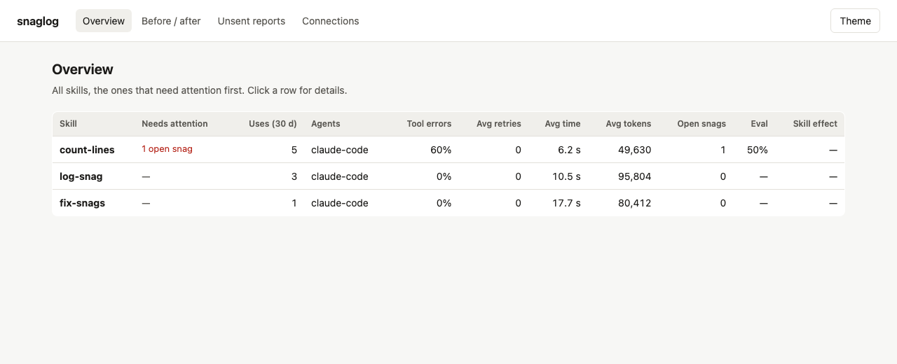
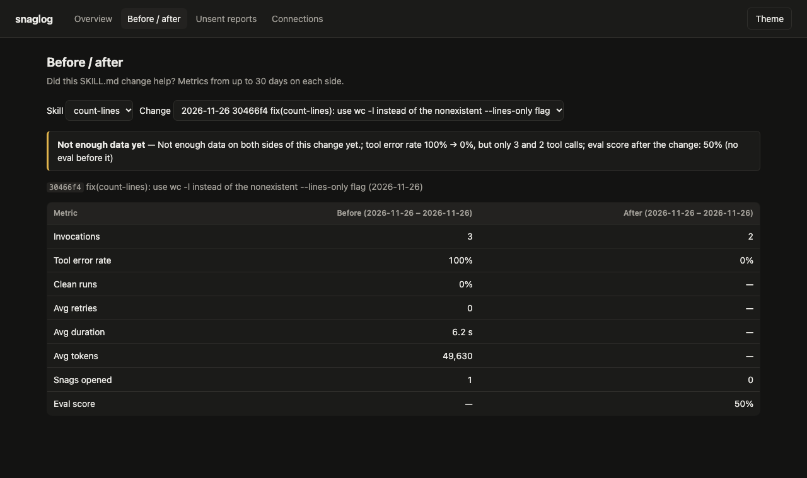

# End-to-end trial (M7)

The full loop was run once for real on 2026-11-26 with Claude Code 2.1.291 (macOS), against a private GitHub test repository holding one deliberately broken skill. Codex was not part of this trial (not installed). Total usage: about $4.5 at API prices, drawn from a Claude subscription.

## Setup

- A private test repository with one skill, `count-lines`, whose step 1 says `wc --lines-only <file>`: a flag no `wc` accepts.
- `snaglog init --repo <owner>/<repo>`: 8 changes (metadata, reminder, bundled `log-snag` and `fix-snags`, eval skeleton, `.gitignore`, two labels created on GitHub).
- `snaglog connect claude-code` was pointed at a temporary `CLAUDE_CONFIG_DIR`; the sessions loaded that generated file with `--settings`, and the repo with `--plugin-dir`, so the user's own Claude Code settings and `~/.snaglog` were never touched.
- `snaglog dashboard` ran the receiver and the dashboard throughout.

## The loop

| Step | What happened | Result |
|---|---|---|
| Snag, unattended | `claude -p` with no way to ask the user | The agent saw it could not get approval and kept the report locally. ✅ |
| Snag, attended | The agent showed the exact report, target repo and visibility, and redactions, and asked | After approval, issue #1 was filed with `skill-friction` and `skill:count-lines`. ✅ |
| Repeat snag | Same failure, slightly different title | Added to #1 as a comment, no new issue. ✅ |
| Unsent report | The locally kept report sent from the dashboard API | Added to #1 as a comment; the unsent list was empty afterwards. ✅ |
| Telemetry | 3 broken runs, then 2 after the fix | Invocations, the failing tool call, durations, tokens and cost per skill; names resolved by the hook. ✅ |
| fix-snags analysis | Asked as the owner | One group, 3 reports; cause found in step 1; local telemetry used as evidence (100% error rate); no suspicious reports. ✅ |
| Fix | Branch, `SKILL.md` change, eval case `snag-1-wc-flag` | Done; see "Skill files are protected" below. ✅ |
| Eval | `snaglog eval count-lines --trust-plugin`, run by the owner in a terminal | 1 case, 3 runs: score 50%, $0.17, recorded with the skill commit. ✅ |
| Pull request | `pr-body`, owner approval, `open-pr` | PR #2 opened with the eval result and `Fixes #1`; not merged. ✅ |
| Before / after | Dashboard for the fix commit | Tool error rate 100% → 0%, honestly marked "not enough data yet" (3 and 2 runs). ✅ |

## Problems found and fixed

1. **Hook command used a versioned node path** (`…/Cellar/node/26.5.1/bin/node`), which disappears on upgrade. The hook now uses the first `node` on `PATH`. `connect` recognises its hook by script path, so a changed command is updated instead of duplicated, and an outdated hook script is refreshed even when settings are unchanged.
2. **Plugin namespaces.** Skills loaded from a repo as a plugin are reported as `<plugin>:<skill>`. The namespace is now dropped everywhere (adapter, hook, dashboard), so telemetry joins snags and evals.
3. **`assistant_response` is not an end-of-turn signal.** It follows every model message with text, and it closed skill windows mid-run. Windows now close on a new prompt, another skill or idle time.
4. **Plugin skills are `third-party` on API events too**, so the API-name fallback does not apply to them; the hook is their only name source. It worked every time in the trial.
5. **`claude plugin eval` cannot ask its trust question when run with `--json`.** `snaglog eval --trust-plugin` asks the user itself in a terminal and only then passes the flag (`--yes` never answers it); `fix-snags` tells agents to leave this to the owner.
6. **The eval-case template used `match: false`**, which `claude plugin eval` rejects; the documented value is `match: not_contains`. The template is fixed and `check-case` now rejects invalid `match` values before any paid run. `snaglog eval` also explains when no case could be loaded.
7. **`disconnect` left an empty `{}`** in a settings file it had created when the file was edited later; it now removes it.
8. **Before/after verdict on small samples** said "no clear change"; it now says "not enough data yet" and lists the numbers it has.

`SNAGLOG_DEBUG_EVENTS=1` (record the shape of incoming events: names, times, tool and skill names, never content) was added to diagnose problem 3.

## Behaviour to know about

- **Skill files are protected.** Claude Code treats skill files as sensitive: every edit needs the user's approval when it happens, and allow rules do not lift this in non-interactive (`-p`) runs. In the trial the agent stopped instead of working around it, and the owner made the three approved edits. In an interactive session the owner approves each edit prompt.
- **The first eval in a repo needs the owner's trust**, in a terminal: `snaglog eval <skill> --trust-plugin`.
- **A low eval score needs the full report to diagnose.** By default snaglog keeps only scores; rerun with `--keep-report` to see which grader failed. In the trial the 50% was most likely caused by the eval workspace not containing the file the case asks about.
- **Telemetry is collected only while `snaglog dashboard` runs.**

## Not covered

- Codex: not installed on the trial machine.
- Team mode: not implemented.
